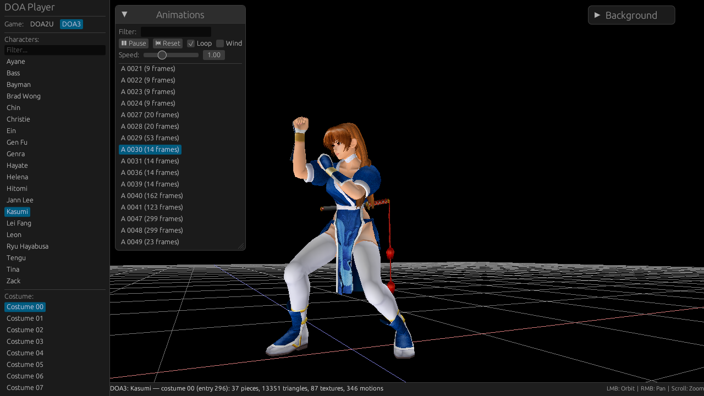

# DOA Player

A native Linux viewer in Rust for the characters of Dead or Alive 3 and Dead or Alive 2 Ultimate. It loads costumes, skeletons and motions from the game files and draws them with wgpu and egui.

It reads files from your own copy of the games. No game data is in this repository.



## Build and run

```bash
./build.sh                                # release build
./build.sh --run                          # build and open the viewer
./build.sh --run --load "Zack" 0 --doa2u  # open a DOA2U character directly
cargo test
```

## Game data

DOA3 is read from `assets/doa3/` and DOA2U from `assets/doa2u/`, which git ignores. DOA2U needs `DOA2.xbe`, `datahdd.afs`, `datahdd2.afs`, `datadvd.afs` and `voice.afs`, about 1.1 GB, copied from your own copy of the game.

## The assets folder

`assets/doa3/` is about 4 GB, and the viewer needs about 370 MB of it. Formats below come from each file's first bytes. The contents of the movies and voices were not watched or heard.

### Used by the viewer

| File | Size | Contents |
| --- | --- | --- |
| `loadfile.afs` | 366 MB | AFS archive, 1102 entries: models, CAT files, motions and character data. 595 entries are `wwww` placeholders. |
| `default.xbe` | 3.9 MB | The game's executable. The viewer reads its tables: roster, bones, costumes. |

Tests also read these two files, and skip their checks if the files are missing.

### Not used by anything in this repository

No code, tool or test refers to these files.

| File | Size | Contents | If you delete it |
| --- | --- | --- | --- |
| `mv_*.sfd` (17 files) | 3.5 GB | Sofdec video (MPEG program stream). Names suggest one per character. | Nothing changes. This is the main saving. |
| `ninja.sfd` | 35 MB | Sofdec video. | Nothing changes. |
| `ninja.aix` | 3.1 MB | AIX audio (magic `AIXF`). It shares its name with `ninja.sfd`, so it may be that video's sound. | Nothing changes. |
| `bgm.afs` | 227 MB | AFS archive: 25 stereo ADX tracks at 44.1 kHz, and 1 placeholder. Probably the music. | Nothing changes today. Keep it to play music later. |
| `voice.afs` | 11 MB | AFS archive: 468 mono ADX clips at 22 kHz, and 412 placeholders. | Nothing changes today. Keep it for the plan below. |
| `dsstdfx.bin` | 26 KB | Probably the Xbox DirectSound effects image, going by its name. | Nothing changes. It is very small. |

Git does not track these files, so a deleted file can only come back from your copy of the game. Keep that copy before deleting anything.

## Possible later work

The viewer plays DOA2U's voices from the Voices window: `voice.afs` in that game has file names, whose prefixes say whose clip it is. DOA3's `voice.afs` has no names, so it is not listed yet. Which clip belongs to which move has not been researched; the move scripts in each character's `.bin` are the first place to look.

## More documentation

- `docs/doa3-internals.md`: how DOA3 works inside.
- `docs/doa2u-notes.md`: DOA2U formats, cipher and pose.
- `docs/viewer-mode-feasibility.md`: reading the memory of the running game.

## Disclaimer

This is an unofficial fan-made project developed for educational and preservation purposes.
Dead or Alive, its characters, artwork, models, textures and other related assets are the property of their respective copyright holders, including Koei Tecmo.
This project is not affiliated with, endorsed by, or sponsored by Koei Tecmo.
No original game assets are distributed with this project.
